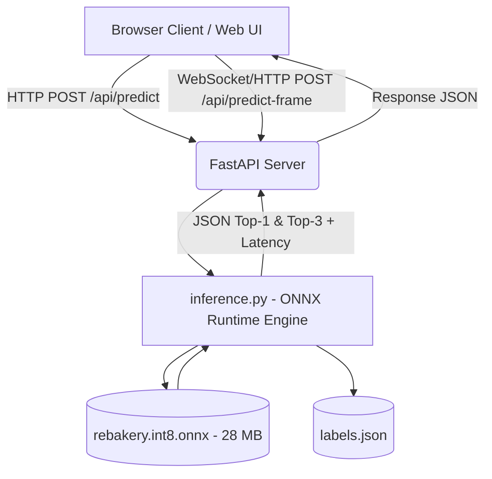

# 🥐 Re:Bakery — AI Bakery Classification Web App
### Master Documentation & New Device Handoff Guide

> **Catatan untuk AI / Developer di Device Baru**:
> Dokumen ini berisi **seluruh arsitektur, struktur proyek, cara menjalankan, serta roadmap rencana selanjutnya** untuk proyek Re:Bakery. Anda dapat langsung melanjutkan pekerjaan berdasarkan panduan ini tanpa kehilangan konteks.

---

## 📌 1. Ringkasan Eksekutif Proyek

**Re:Bakery** adalah aplikasi web visual berbasis AI (Computer Vision) yang dapat mendeteksi dan mengklasifikasikan **8 jenis produk bakery**:
1. 🥖 **Baguette**
2. 🥐 **Croissant**
3. 🌀 **Cromboloni**
4. 🍩 **Donut** (isi / bomboloni)
5. ⭕ **Hole Donut** (donat berlubang cincin)
6. 🥧 **Pie Susu**
7. 🥨 **Pretzel**
8. 🍞 **Sliced Bread** (roti tawar)

### Fitur Utama:
- **Mode 1: Upload Gambar**: Drag-and-drop atau browse file (JPG, PNG, WEBP, HEIC) dengan visualisasi hasil top-1, confidence bar, top-3 prediksi, dan waktu inferensi (ms).
- **Mode 2: Realtime Webcam**: Streaming kamera langsung dengan auto-inference interval ~350ms, frame targeting reticle, switch kamera depan/belakang, dan confidence tracking.
- **Visual & UI/UX**: Warm bakery aesthetic (palette espresso, cinnamon, caramel, linen), full-screen loading splash animation dengan roti terapung, landing page hero banner dengan motion bread orbiter & particles, serta scroll-revealed dashboard.
- **Arsitektur Ringan (No-Node.js)**: Frontend murni HTML5 + Tailwind CSS CDN + Vanilla JS yang di-serve langsung oleh FastAPI. Tidak membutuhkan Node.js/npm di komputer lokal.

---

## 🏗️ 2. Arsitektur & Teknologi



| Komponen | Teknologi | Deskripsi |
|---|---|---|
| **Deep Learning Backbone** | `EfficientNet-B0` | Transfer learning pre-trained, 2-phase training (Frozen -> Fine-tune top 30%). |
| **Model Runtime** | `ONNX Runtime` | CPU inference memakai `rebakery.int8.onnx` (~28 MB); `rebakery.onnx` FP32 digunakan sebagai fallback lokal jika tersedia. |
| **Akurasi Model** | **95.95% Test Acc** | Best validation accuracy: **98.61%**. |
| **Backend Framework** | `FastAPI` (Python) | High-performance asynchronous API + Static file server. |
| **Web Server** | `Uvicorn` | ASGI server running at port 8000. |
| **Frontend** | HTML5, Tailwind CDN, Lucide Icons | Single file di `backend/static/index.html`. Responsive & zero build step. |

---

## 📂 3. Struktur Direktori Proyek

```
ComVis - ReBakery/
│
├── backend/                              # Server & Machine Learning Backend
│   ├── models/
│   │   ├── rebakery.int8.onnx            # Model kuantisasi untuk deployment (~28 MB) [WAJIB ADA]
│   │   ├── rebakery.onnx                 # Model FP32 lokal (opsional; tidak disertakan di deployment)
│   │   └── labels.json                   # Metadata 8 kelas, class_to_idx, & emoji
│   ├── static/
│   │   └── index.html                    # Frontend Web App (UI Warm Bakery + Motion)
│   ├── Dockerfile                        # Kontainer Docker untuk deployment cloud
│   ├── inference.py                      # Engine inferensi ONNX & normalisasi ImageNet
│   ├── main.py                           # Server FastAPI (endpoints /api/predict & /api/predict-frame)
│   └── requirements.txt                  # Dependensi Python
│
├── frontend/
│   └── Sample/                            # Foto contoh kelas yang disajikan aplikasi web
│
├── Dataset/                              # Dataset gambar lokal (~469 raw images)
│   ├── Baguette/
│   ├── Croissant/
│   ├── Cromboloni/
│   ├── Donut/
│   ├── Hole_Donut/
│   ├── Pie_Susu/
│   ├── Pretzel/
│   └── Sliced_Bread/
│
├── workflows/                            # SOP & Design Architecture Workflows
│   ├── wf-ai-engineer.md
│   ├── wf-tech-architect.md
│   ├── wf-ui-ux-designer.md
│   └── ...
│
├── run_web.bat                           # Script Windows 1-klik untuk auto-run web server
└── README.md                             # Dokumen panduan ini
```

---

## ⚡ 4. Kebutuhan & Prasyarat di Device Baru

### Prasyarat Software:
1. **Python**: Versi `3.10`, `3.11`, `3.12`, atau `3.13`.
   - *Pastikan centang "Add Python to PATH" saat menginstall Python di Windows.*
2. **Web Browser**: Google Chrome, Microsoft Edge, Firefox, atau Safari modern.
3. **Hardware**:
   - RAM: Minimal 4 GB.
   - Processor: CPU modern apa saja (inferensi dijalankan di CPU via ONNX Runtime).
   - Webcam (Opsional): Dibutuhkan jika ingin mencoba fitur *Realtime Kamera*.
4. **Node.js**: **TIDAK DIBUTUHKAN** (proyek ini bebas dependensi Node.js / npm).

---

## 🚀 5. Cara Menjalankan di Device Baru (Step-by-Step)

### Cara 1: Menggunakan Script Otomatis (Windows)
1. Salin seluruh folder `ComVis - ReBakery` ke device baru.
2. Pastikan file `backend/models/rebakery.int8.onnx` dan `backend/models/labels.json` sudah ada. Model FP32 `rebakery.onnx` dapat digunakan sebagai fallback lokal.
3. **Klik dua kali file `run_web.bat`**.
   - Script akan otomatis mendeteksi Python.
   - Menginstall dependensi dari `backend/requirements.txt`.
   - Menjalankan server di `http://localhost:8000`.
4. Buka browser ke: **`http://localhost:8000`**

---

### Cara 2: Manual Lewat Terminal / Command Prompt / Terminal Mac/Linux

#### Langkah 1: Buka Terminal di folder proyek
```bash
cd "ComVis - ReBakery"
```

#### Langkah 2: Buat & Aktifkan Virtual Environment (Direkomendasikan)
- **Windows (CMD / PowerShell)**:
  ```powershell
  python -m venv venv
  .\venv\Scripts\activate
  ```
- **macOS / Linux**:
  ```bash
  python3 -m venv venv
  source venv/bin/activate
  ```

#### Langkah 3: Install Dependensi
```bash
pip install -r backend/requirements.txt
```
*Isi `requirements.txt`:*
- `fastapi>=0.115.0`
- `uvicorn>=0.31.0`
- `onnxruntime>=1.20.0`
- `pillow>=11.0.0`
- `numpy>=1.26.0`
- `python-multipart>=0.0.12`
- `pydantic>=2.9.2`

#### Langkah 4: Jalankan Server
```bash
cd backend
python main.py
```
*Atau gunakan Uvicorn langsung:*
```bash
uvicorn main:app --host 0.0.0.0 --port 8000 --reload
```

#### Langkah 5: Akses Aplikasi
- Buka browser: **`http://localhost:8000`**
- Dokumentasi API Swagger interaktif: **`http://localhost:8000/docs`**
- Cek status sistem: **`http://localhost:8000/api/health`**

---

## 📡 6. Dokumentasi API Endpoints

### 1. `GET /api/health`
Mengecek apakah server dan model ONNX aktif.
- **Response**:
  ```json
  {
    "status": "ok",
    "model_loaded": true,
    "classes": ["Baguette", "Croissant", "Cromboloni", "Donut", "Hole_Donut", "Pie_Susu", "Pretzel", "Sliced_Bread"]
  }
  ```

### 2. `POST /api/predict`
Prediksi dari file upload form-data.
- **Header**: `Content-Type: multipart/form-data`
- **Body**: `file: [binary image]`
- **Response**:
  ```json
  {
    "success": true,
    "filename": "croissant.jpg",
    "prediction": {
      "class": "Croissant",
      "confidence": 98.45,
      "emoji": "🥐"
    },
    "top3": [
      { "class": "Croissant", "confidence": 98.45, "emoji": "🥐" },
      { "class": "Cromboloni", "confidence": 1.20, "emoji": "🌀" },
      { "class": "Baguette", "confidence": 0.15, "emoji": "🥖" }
    ],
    "inference_time_ms": 38.4
  }
  ```

### 3. `POST /api/predict-frame`
Prediksi frame realtime webcam berbasis Base64.
- **Header**: `Content-Type: application/json`
- **Body**:
  ```json
  {
    "image_base64": "data:image/jpeg;base64,/9j/4AAQSkZJRg..."
  }
  ```
- **Response**: Format sama dengan `/api/predict`.

---

## 🗺️ 7. Master Roadmap & Rencana Pengembangan Selanjutnya (Next Plan)

Bagi AI atau Developer berikutnya, berikut adalah daftar prioritas tugas yang telah direncanakan:

### 🎯 Tahap 1: Peningkatan Fitur UI/UX (Frontend)
- [ ] **Informasi Gizi & Fakta Bakery**: Tambahkan kartu informasi estimasi kalori / asal roti ketika hasil deteksi keluar (misal: *Croissant: ~260 kcal · Berasal dari Prancis/Austria*).
- [ ] **Riwayat Deteksi (History Log)**: Simpan 5 hasil deteksi terakhir di `localStorage` browser agar user bisa melihat riwayat roti yang sudah dipindai.
- [ ] **Audio Chime Effect**: Suara "ding" halus bernuansa kafe ketika AI berhasil mendeteksi objek dengan akurasi >80%.
- [ ] **Export Hasil / Share**: Tombol untuk mendownload ringkasan hasil deteksi dalam format gambar/kartu sertifikat AI.

### 🌐 Tahap 2: Deployment ke Cloud (Online Production)
Saat ini aplikasi berjalan di `localhost:8000`. Untuk dipublikasikan ke internet:
- [ ] **Target 1: Hugging Face Spaces (Direkomendasikan - Gratis & Mudah)**:
  - Gunakan runtime `Docker`. Proyek sudah memiliki `backend/Dockerfile`.
  - Push repo ke Hugging Face Space SDK Docker.
  - Model ONNX 19.1 MB dapat di-host langsung tanpa biaya.
- [ ] **Target 2: Render / Railway + Vercel**:
  - Deploy backend FastAPI di Render/Railway.
  - Deploy frontend terpisah atau bersamaan.
  - *Penting*: Akses webcam di browser smartphone wajib menggunakan protokol **HTTPS**. Deployment ke cloud otomatis menyediakan SSL/HTTPS gratis.

### 🧠 Tahap 3: Optimasi Model & Edge AI (Opsional)
- [ ] **Inference Sisi Browser Murni (ONNX Runtime Web / TF.js)**:
  - Ekspor model ke ONNX Runtime Web / TensorFlow.js Graph Model agar inferensi webcam berjalan 100% di GPU browser client tanpa mengirim frame ke server (0ms server latency, hemat bandwidth).
- [ ] **Pembersihan Data Duplikat**:
  - Catatan evaluasi dataset: Ada 4 file duplikat byte-for-byte antara `Donut/` dan `Hole_Donut/` (`IMG_1315`, `IMG_1316`, `IMG_1332`, `IMG_1352`) yang bisa dihapus jika akan melakukan re-training di masa depan.
- [ ] **Penambahan Kelas Baru**:
  - Menambah varian bakery populer lainnya seperti *Cinnamon Roll*, *Sourdough*, *Muffin*, atau *Churros*.

---

## 💡 8. Troubleshooting Cepat untuk Device Baru

1. **Error: `ModuleNotFoundError: No module named 'onnxruntime'`**
   - Jalankan: `pip install onnxruntime` (atau `pip install -r backend/requirements.txt`).
2. **Kamera Web tidak menyala**:
   - Jika dibuka di luar `localhost` (misal via IP LAN `http://192.168.x.x`), browser memblokir kamera karena bukan HTTPS. Jalankan di `localhost:8000` atau deploy dengan domain ber-HTTPS.
3. **Error: `Model belum dimuat. Periksa folder backend/models/`**:
   - Pastikan `rebakery.int8.onnx` atau `rebakery.onnx` dan `labels.json` berada di dalam folder `backend/models/`.

---
*Dokumen ini dibuat otomatis sebagai panduan handoff resmi proyek Re:Bakery.*
